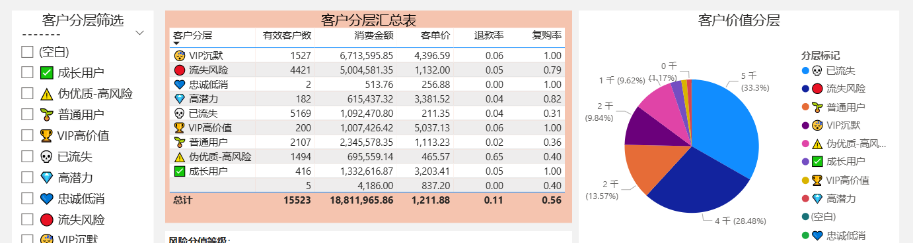
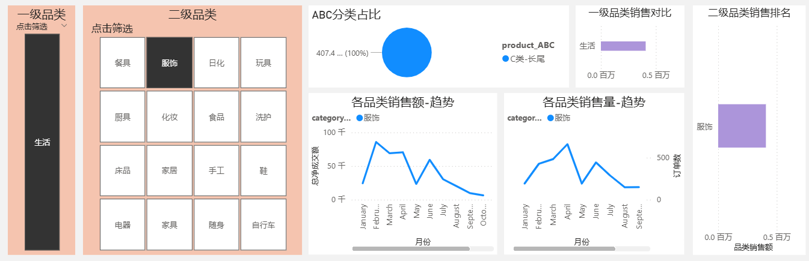
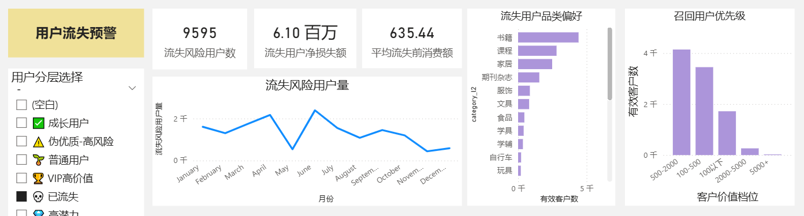
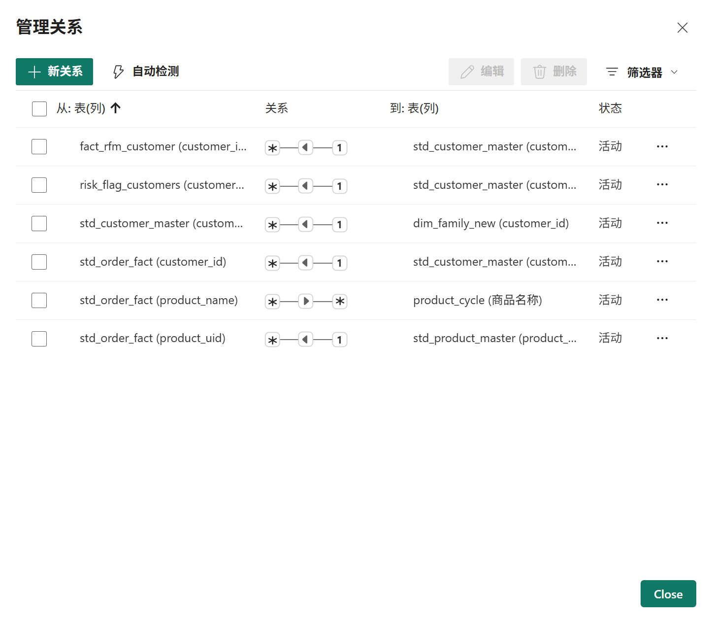

# E-Commerce Customer Intelligence & Risk Analytics

**Cross-Platform Data Integration · Power BI · Customer Segmentation · Retention Risk · Business Intelligence**

A portfolio case study from an e-commerce analytics initiative undertaken during an internship in China. The project addressed a practical problem: transaction, customer, and product information was scattered across platforms, making consistent reporting and customer-level analysis difficult.

The work brought together data standardization, customer and product analytics, **Power BI reporting**, and a separate **interactive HTML-based business dashboard**. The goal was to make fragmented data more useful for everyday decisions—not just produce charts.

> **Portfolio note:** The original documentation and interfaces are in Chinese. English descriptions are provided here. The screenshots show historical project views; this repository does not contain an executable reproduction of the original systems.

## At a Glance

| Business question | Analytical approach | Intended use |
| --- | --- | --- |
| Who are our most valuable customers? | RFM scoring, purchase frequency, spending patterns | Customer segmentation and prioritization |
| Which customers may be disengaging? | Recency-based segments and rule-based risk indicators | Retention outreach and customer review |
| Which products warrant attention? | Revenue contribution, ABC classification, refund indicators | Product selection and quality review |
| Where is demand concentrated? | Geographic customer and sales summaries | Regional performance analysis |

## Two Complementary Analytics Components

### 1. Power BI — Data Modeling & Analytical Reporting

Power BI provided the reporting and modeling environment. The preserved project contains Power Query transformation steps, model relationships, DAX measures, and customer/product analysis reports.

| Technical area | Evidence from the archived project |
| --- | --- |
| **Power Query (M)** | Conditional customer-identifier fallback, composite product keys, text cleanup, and field-type standardization |
| **Data modeling** | Six active relationships linking order, customer, product, family, RFM, and risk-related tables |
| **DAX** | RFM recency/frequency/monetary scoring and average revenue per customer |
| **Reporting** | Customer segmentation, product/category trends, and retention-risk views |

**Selected Power BI reports**

*Customer segmentation and value reporting.*

*Category-based product performance, ABC classification, and sales trends.*

*Aggregated retention-risk and customer-prioritization indicators.*

**Underlying model relationships**

The preserved model has **five many-to-one relationships and one many-to-many relationship**. The latter is a modeling consideration, not evidence of a perfect star schema; filtering and aggregation behavior would need to be validated before reuse.

**Explore the technical implementation:**

- [Power BI technical showcase](powerbi/README.md)
- [DAX: RFM scoring and business KPIs](powerbi/dax_measures.md)
- [Power Query M: selected transformations](powerbi/power_query.md)

### 2. HTML Dashboard — Interactive Business Decision Support

The web-based dashboard is a separate business-facing interface within the broader initiative. It provides additional exploration and action-oriented views, including customer segments, product evaluations, geographic summaries, rule-based warnings, and business reminders.

It is presented alongside Power BI as a **complementary component**. The surviving materials do not establish that the HTML application directly consumed a Power BI dataset or shared an automated data pipeline with it.

**Customer segmentation and behavior**

**Retention and refund-risk monitoring**

**Product selection and performance**

**Geographic analysis**

Additional selected views are available in the [`dashboards/`](dashboards/) folder. The original HTML application is **not published** because its embedded records include business and customer information.

## Data Architecture & Integration

The architecture documentation describes how source records could be standardized and organized into analytical tables. Some diagrams contain design-stage or proposed rules, so they should **not** be read as proof that every documented feature was deployed.

### Data Processing Overview

The documented workflow covers source preparation, standardization, dataset consolidation, feature calculations, metric definitions, and analysis outputs.

### Core Analytical Datasets

The proposed unified structure centers on **order-level facts**, **customer profiles**, and **product records**, with aligned identifiers and consistent metric definitions.

### Customer Matching Design

A layered entity-resolution design accounts for inconsistent customer identifiers, varying confidence, and cases requiring manual review. The design diagram includes later-stage matching ideas; only the transformations documented in the archived code should be treated as verified implementation.

## Methods & Business Applications

- **Customer analytics:** RFM scoring and rule-based customer segmentation to distinguish recent, frequent, and high-spending customers.
- **Risk monitoring:** Inactivity and refund-rate indicators for triage and investigation—not a validated predictive churn model.
- **Product analytics:** ABC classification, category trends, sales concentration, and refund review.
- **Business intelligence:** Linked data tables, DAX measures, interactive filtering, and drill-down reporting.
- **Data quality:** Field mapping, handling missing identifiers, composite product keys, and documented matching caveats.

These capabilities support *potential decisions* such as retention prioritization and product review. This repository does **not** claim independently measured increases in revenue or reductions in churn.

## Scope, Privacy & Availability

This is an **archived portfolio case study**, not a fully reproducible open-source application.

- The original work involved real customer transactions and internal business information. Customer-level datasets, original PBIX files, and the HTML application are not distributed here.
- The original development environment was decommissioned; some source files, historical processing scripts, and intermediate artifacts are no longer available.
- The repository includes selected images, surviving technical examples, and design documentation. Some images and figures reflect different historical versions and should not be assumed to reconcile exactly.
- Images are excerpts, not live dashboards. Any publication of proprietary architecture or aggregated business information requires appropriate authorization from the original owner.

## Repository Guide

| Folder | Contents |
| --- | --- |
| [`architecture/`](architecture/) | Original Chinese-language architecture and matching-design diagrams |
| [`dashboards/`](dashboards/) | Selected HTML-dashboard screenshots |
| [`powerbi/`](powerbi/) | Power BI report excerpts, data relationships, DAX documentation, and Power Query M examples |

---

*Focus: Business Analytics · Data Analytics · Business Intelligence · Customer Intelligence · Risk Strategy*
